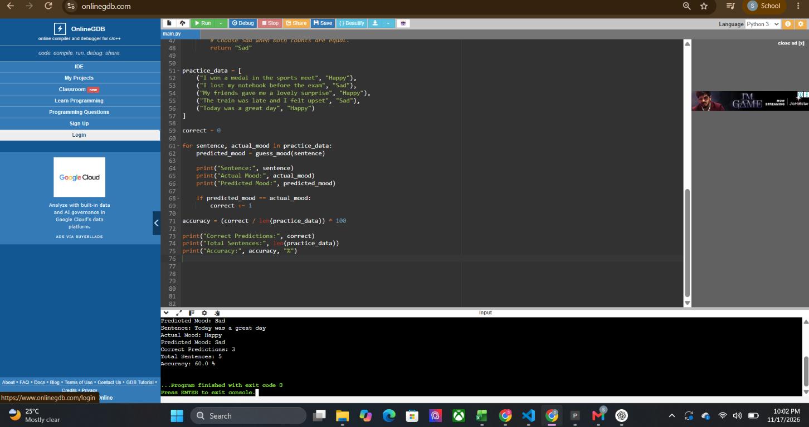
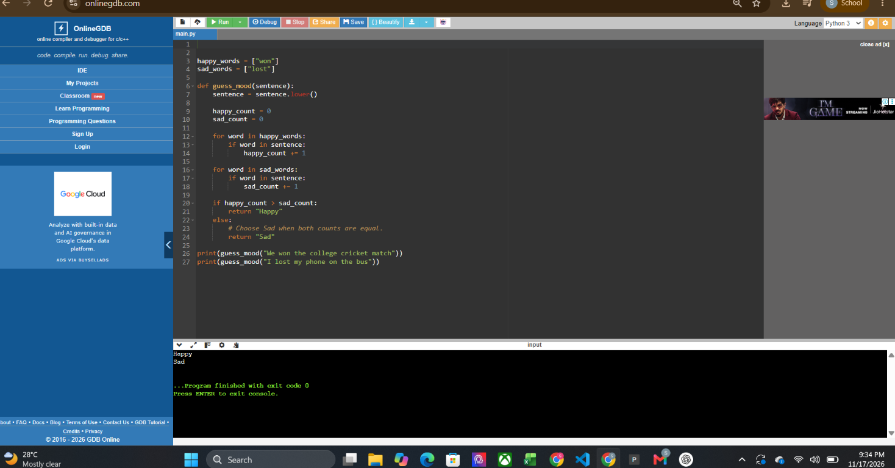
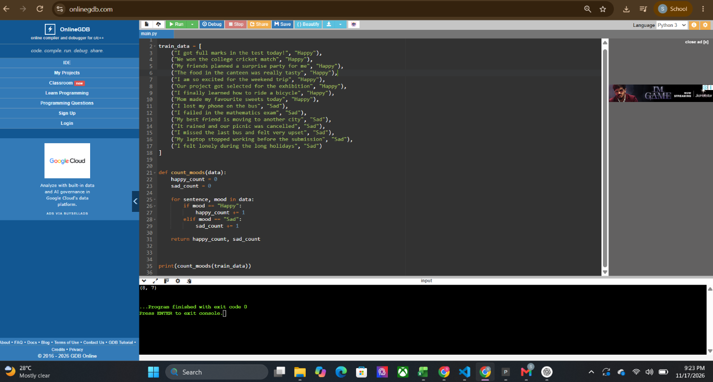

# AIXcelerate Mood Guesser

A beginner-friendly Python project that predicts whether a sentence sounds Happy or Sad using simple rule-based clue words. The program counts moods from a training dataset and checks prediction accuracy on sample practice sentences.

## Project idea
This project is designed for learning how a basic text-based classifier works. It uses a small set of example sentences and a few key words to decide the mood.

## Features
- Uses a training dataset with both Happy and Sad examples
- Cleans sentence text by removing punctuation before checking words
- Uses clue words to guess the mood
- Prints the mood count and practice-test accuracy

## How to run
Open a terminal in the same folder as `main.py` and run:

```bash
python main.py
```

## Sample output
```text
LEVEL 1 - MOOD COUNT
Mood Count: (8, 7)

LEVEL 3 - PRACTICE TEST

Sentence: I won a medal in the sports meet
Actual Mood: Happy
Predicted Mood: Happy

Sentence: I lost my notebook before the exam
Actual Mood: Sad
Predicted Mood: Sad

Sentence: My friends gave me a lovely surprise
Actual Mood: Happy
Predicted Mood: Sad

Sentence: The train was late and I felt upset
Actual Mood: Sad
Predicted Mood: Sad

Sentence: Today was a great day
Actual Mood: Happy
Predicted Mood: Sad

Correct Predictions: 3
Total Sentences: 5
Accuracy: 60.0 %
```

## Screenshots

### Screenshot 1


### Screenshot 2


### Screenshot 3


## File structure
- `main.py` – main program logic
- `README.md` – project documentation
- `screenshot-1.png`
- `screenshot-2.png`
- `screenshot-3.png`

## Notes
This is a simple rule-based method and is meant for learning, not for production-grade sentiment analysis.
